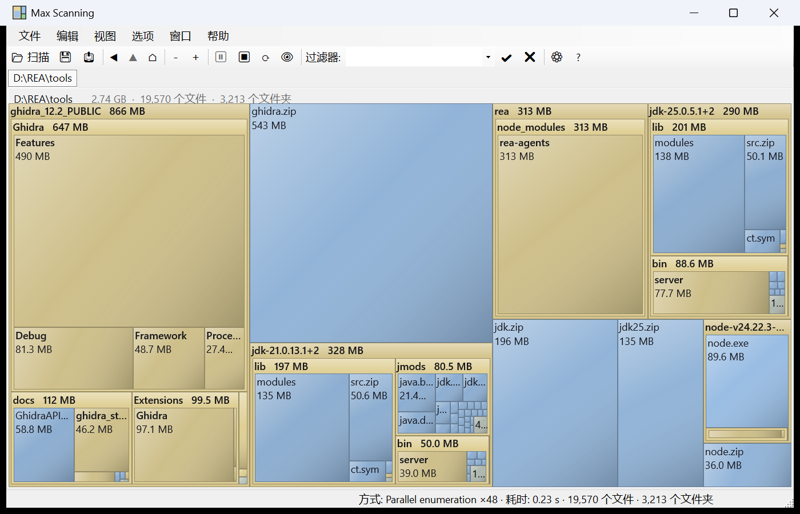

<div align="center">

# Max Scanning

**Visualizador del espacio en disco para Windows, ultrarrápido y preciso**

[English](README.md) · [简体中文](README.zh-CN.md) · **Español**

[](https://github.com/maxbobo007/max-scanning/releases/latest)




</div>

Max Scanning dibuja tu disco como un mapa de árbol (treemap) para que veas de un vistazo qué está ocupando espacio. Incluye todas las funciones del clásico SpaceSniffer 1.1.2, con el motor de escaneo, el modelo de datos y el renderizado reescritos desde cero:

- **Lee directamente la tabla maestra de archivos (MFT) de NTFS cuando se ejecuta como administrador.** Escanea 1,58 millones de archivos en unos 2 segundos sin abrir ni una sola carpeta.
- **Renderizado por GPU** (Direct2D): alrededor de 1 ms por fotograma y nitidez en pantallas de alta resolución.
- **Almacenamiento en columnas de 64 bits.** Millones de archivos sin bloqueos y sin el límite de memoria de 2 GB.

## Descarga

Descárgalo desde [**Releases**](https://github.com/maxbobo007/max-scanning/releases/latest):

| Archivo | Descripción |
|---|---|
| `MaxScanning-1.0.0-win-x64-portable.exe` | **Recomendado.** Un solo archivo con el entorno de ejecución incluido. Se descarga y se usa, sin instalar nada (unos 52 MB). |
| `MaxScanning-1.0.0-win-x64.exe` | Ligero (unos 3 MB). Necesita el [.NET 10 Desktop Runtime](https://dotnet.microsoft.com/download/dotnet/10.0). |

> 💡 Haz clic derecho → **Ejecutar como administrador** para activar el **escaneo turbo MFT**. Sin permisos de administrador se usa automáticamente un escaneo multihilo. El menú Opciones también permite reiniciar como administrador con un clic.

## Rendimiento

Prueba en un Ryzen 7 5800H con SSD NVMe, ejecutado como administrador.

| Volumen | Entradas | Método | Tiempo |
|---|---:|---|---:|
| C: (400 GB, sistema) | 1.581.220 | MFT de NTFS | **1,9 s** |
| D: (349 GB) | 252.849 | MFT de NTFS | **0,58 s** |
| E: (1,09 TB) | 276.542 | MFT de NTFS | **0,73 s** |
| F: (1,82 TB) | 98.460 | enumeración en paralelo | 0,9 s |

- **Preciso:** el espacio ocupado que se obtiene coincide con el espacio usado que indica Windows, con menos de un 0,1 % de diferencia.
- **Ligero:** 1,5 millones de entradas ocupan unos 330 MB de RAM. Las instantáneas se guardan y se cargan en menos de 0,1 s.

## Funciones

**Escaneo**
- Unidades, cualquier carpeta y rutas de red (`\\servidor\recurso`)
- Pausar, reanudar, detener y volver a escanear. Flujos de datos alternativos (ADS) opcionales.
- **Vigilancia en vivo:** cuando cambian los archivos, solo se vuelven a escanear las carpetas afectadas y la vista se actualiza sola.

**Mapa de árbol**
- Cajas anidadas con barra de título. El nivel de detalle se cambia con `+`, `-` o Ctrl+rueda.
- Tamaño mínimo de celda y proporción ajustables, orden por tamaño o por nombre, sombreado en relieve
- Resaltado al pasar el ratón (con profundidad y desvanecimiento ajustables) y zoom animado
- Se puede mostrar el **espacio libre** y el **espacio desconocido** en la raíz de la unidad

**Navegación**
- Doble clic en una carpeta para entrar en ella. Retroceso o el botón central del ratón suben un nivel, el botón «atrás» del ratón vuelve atrás e Inicio va a la raíz.
- Barra de ruta con enlaces. Varias vistas en pestañas (Ctrl+T).

**Filtros** (sintaxis compatible con SpaceSniffer, ampliada)
```
*.mp4;*.mkv;>500mb        vídeos de más de 500 MB
>1y;>100mb                archivos sin modificar desde hace un año y de más de 100 MB
|*.dll;|*.exe             todo excepto dll y exe
:red                      elementos con etiqueta roja (las de una carpeta se aplican a su contenido)
@h  @s  @c                archivos ocultos / de sistema / comprimidos
modified>2024-01-01       fechas absolutas
folder:node_modules       archivos dentro de carpetas con ese nombre
regex:^IMG_\d+\.jpe?g$    expresiones regulares
```
Las condiciones del mismo tipo se combinan con «o», las de tipos distintos con «y», y `|` excluye. La referencia completa está en Ayuda → Ayuda de filtros.

**Más**
- **Etiquetas** roja, verde, azul y amarilla (Ctrl+1–4). Se puede filtrar por etiqueta.
- **Exportación** mediante plantillas (cabecera, detalle y pie con marcadores) con vista previa en vivo. Incluye CSV, TXT, árbol, HTML y JSON, y puedes guardar tus propios ajustes.
- **Instantáneas**: guarda un escaneo completo, con etiquetas, como archivo `.mscan` y ábrelo cuando quieras.
- **Menú contextual**: abrir, mostrar en el Explorador, símbolo del sistema aquí, copiar ruta, propiedades, eliminar a la papelera o de forma definitiva, volver a escanear la carpeta
- **Configuración**: gráficos, efectos, acciones y colores totalmente ajustables. La configuración se puede importar y exportar.
- Consola de eventos, parpadeo de la ventana al terminar el escaneo, y arrastrar y soltar carpetas o instantáneas
- Interfaz en **English / 中文**

## Comparación con SpaceSniffer 1.1.2

| | SpaceSniffer 1.1.2 | Max Scanning |
|---|---|---|
| Escaneo | `FindFirstFileW` recursivo en un solo hilo | lectura directa de la MFT, o enumeración por lotes con 48 hilos |
| Arquitectura y memoria | 32 bits, 2 GB como máximo | 64 bits, almacenamiento en columnas |
| Renderizado | GDI (CPU) | Direct2D (GPU) + DirectWrite |
| Alta resolución (DPI) | no compatible (se ve borroso) | Per-Monitor V2 |
| Enlaces duros | se cuentan una vez por ruta, así que el total puede superar la capacidad del disco | se cuentan una sola vez, así que el total es exacto |
| Archivos en la nube (OneDrive / Dropbox) | se cuentan por su tamaño lógico | se cuentan por lo que ocupan realmente (0 si no están descargados) |

## Línea de comandos

```
MaxScanning.exe D:\                          abrir y escanear
MaxScanning.exe --load scan.mscan            abrir una instantánea
MaxScanning.exe D:\ --bench --out r.txt      escaneo sin interfaz con totales
MaxScanning.exe D:\ --verify                 comparar el escaneo MFT con la enumeración de carpetas (comprobación de precisión)
MaxScanning.exe D:\ --export a.csv --preset CSV --filter ">100mb"
MaxScanning.exe D:\ --save-snapshot d.mscan
MaxScanning.exe --selftest D:\Una\Carpeta --out report.txt   autoprueba automática (41 comprobaciones)
```

## Compilar desde el código fuente

Requiere el [.NET 10 SDK](https://dotnet.microsoft.com/download/dotnet/10.0).

```bash
dotnet build -c Release
# versión ligera (necesita el entorno de ejecución de .NET)
dotnet publish -c Release -r win-x64 --self-contained false -p:PublishSingleFile=true -p:PublishReadyToRun=true -o publish/MaxScanning
# versión portátil (entorno de ejecución incluido)
dotnet publish -c Release -r win-x64 --self-contained true -p:PublishSingleFile=true -p:PublishReadyToRun=true -p:IncludeNativeLibrariesForSelfExtract=true -p:EnableCompressionInSingleFile=true -o publish/MaxScanning-portable
```

### Estructura del código
```
src/Core      FileTree: almacenamiento en columnas con tabla de hijos CSR; Util
src/Scan      MftScanner: lectura directa de la MFT, análisis en paralelo
              DirScanner: enumeración de carpetas en paralelo
              ScanEngine: elige el método de escaneo automáticamente
src/Filter    FilterSet: lenguaje de filtros
src/View      TreemapLayout: diseño squarified
              D2DRenderer: renderizado por GPU
              ScanView: una vista (navegación, filtros, etiquetas, vigilancia)
src/UI        MainForm, StartDialog, ConfigForm, ExportForm, ConsoleForm, HelpForm
src/IO        Exporter: exportación con plantillas; Snapshot: instantáneas
src/Settings  Config: configuración JSON; L: textos bilingües
```

## Licencia

[MIT](LICENSE) © 2026 maxbobo007

Este proyecto no tiene ninguna relación con SpaceSniffer ni con su autor. Todo el código se ha escrito de forma independiente. El nombre «SpaceSniffer» solo se usa para describir la equivalencia de funciones.
