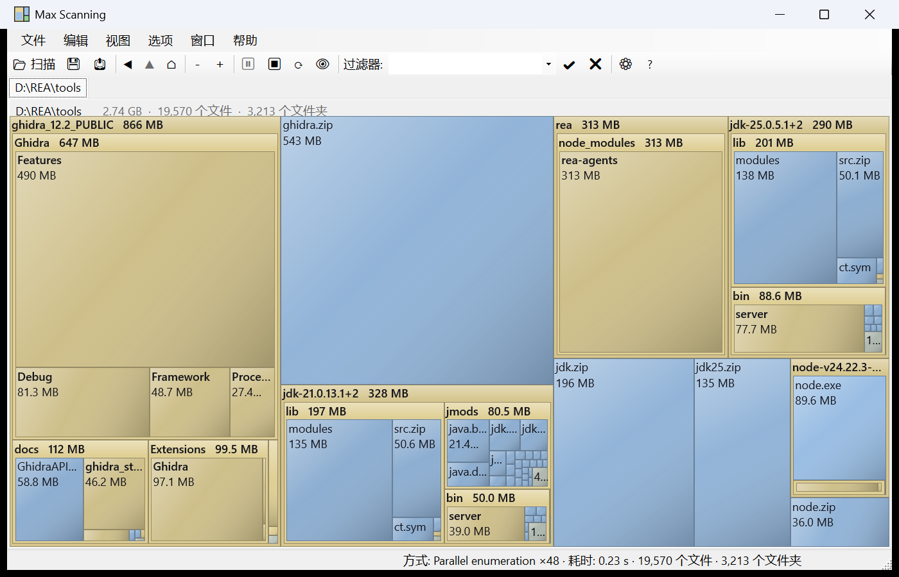

<div align="center">

# Max Scanning

**A blazing-fast, accurate disk space treemap for Windows**

**English** · [简体中文](README.zh-CN.md) · [Español](README.es.md)

[](https://github.com/maxbobo007/max-scanning/releases/latest)




</div>

Max Scanning draws a treemap of your disk, so you can see at a glance what is using your space. It covers every feature of the classic SpaceSniffer 1.1.2, with the scan engine, data model and renderer rewritten from scratch:

- **Reads the NTFS Master File Table directly when run as administrator.** 1.58 million files are scanned in about 2 seconds, without opening a single directory.
- **GPU rendering** (Direct2D) at about 1 ms per frame, sharp on high-DPI displays.
- **64-bit column-store data model.** Millions of files stay responsive, with no 2 GB memory ceiling.

## Download

Get it from [**Releases**](https://github.com/maxbobo007/max-scanning/releases/latest):

| File | Notes |
|---|---|
| `MaxScanning-1.0.0-win-x64-portable.exe` | **Recommended.** Single file with the runtime bundled. Download and run, no install (~52 MB). |
| `MaxScanning-1.0.0-win-x64.exe` | Small (~3 MB). Requires the [.NET 10 Desktop Runtime](https://dotnet.microsoft.com/download/dotnet/10.0). |

> 💡 Right-click → **Run as administrator** to enable the **MFT turbo scan**. Without elevation, a multi-threaded scan is used automatically. The Options menu also offers a one-click restart as administrator.

## Performance

Tested on a Ryzen 7 5800H with an NVMe SSD, running as administrator.

| Volume | Entries | Method | Time |
|---|---:|---|---:|
| C: (400 GB, system) | 1,581,220 | NTFS MFT | **1.9 s** |
| D: (349 GB) | 252,849 | NTFS MFT | **0.58 s** |
| E: (1.09 TB) | 276,542 | NTFS MFT | **0.73 s** |
| F: (1.82 TB) | 98,460 | parallel enumeration | 0.9 s |

- **Accurate:** the scanned size on disk matches the used space Windows reports to within 0.1%.
- **Light:** 1.5 million entries take about 330 MB of RAM. Snapshots save and load in under 0.1 s.

## Features

**Scanning**
- Drives, any folder and network paths (`\\server\share`)
- Pause, resume, stop and rescan. Alternate data streams (ADS) are optional.
- **Live watch:** when files change, only the affected folders are rescanned and the view updates on its own.

**Treemap**
- Nested boxes with title bars. Change the detail level with `+`, `-` or Ctrl+wheel.
- Adjustable minimum cell size and aspect ratio, sorting by size or by name, cushion shading
- Hover highlight (highlight depth and fade-out are adjustable) and animated zoom
- **Free space** and **unknown space** can be shown at the drive root

**Navigation**
- Double-click a folder to zoom into it. Backspace or the middle mouse button goes up a level, the mouse back button goes back, and Home returns to the root.
- Clickable breadcrumb bar. Open several views as tabs (Ctrl+T).

**Filters** (SpaceSniffer-compatible syntax, with extensions)
```
*.mp4;*.mkv;>500mb        videos larger than 500 MB
>1y;>100mb                files untouched for a year and larger than 100 MB
|*.dll;|*.exe             everything except dll and exe
:red                      red-tagged items (folder tags apply to their contents)
@h  @s  @c                hidden / system / compressed files
modified>2024-01-01       absolute dates
folder:node_modules       files inside folders with this name
regex:^IMG_\d+\.jpe?g$    regular expressions
```
Terms of the same kind are OR-ed, different kinds are AND-ed, and `|` excludes. The full reference is under Help → Filter help.

**More**
- **Tags** in red, green, blue and yellow (Ctrl+1–4). You can filter by tag.
- **Export** through templates (header, detail and footer with placeholders) with a live preview. CSV, TXT, tree, HTML and JSON are built in, and you can save your own presets.
- **Snapshots**: save a full scan, tags included, as a `.mscan` file and reopen it any time.
- **Context menu**: open, show in Explorer, command prompt here, copy path, properties, delete to the Recycle Bin or permanently, rescan this folder
- **Configuration**: graphics, effects, actions and colors are all adjustable. Settings can be imported and exported.
- Event log console, a taskbar flash when a scan completes, and drag & drop for folders and snapshots
- **English / 中文** user interface

## Compared with SpaceSniffer 1.1.2

| | SpaceSniffer 1.1.2 | Max Scanning |
|---|---|---|
| Scanning | single-threaded recursive `FindFirstFileW` | direct MFT read, or 48-thread batched enumeration |
| Architecture & memory | 32-bit, 2 GB maximum | 64-bit, column store |
| Rendering | GDI (CPU) | Direct2D (GPU) + DirectWrite |
| High DPI | not supported (blurry) | Per-Monitor V2 |
| Hard links | counted once per path, so totals can exceed the disk size | counted once, so totals are exact |
| Cloud files (OneDrive / Dropbox) | counted at their logical size | counted at their real size on disk (0 if not downloaded) |

## Command line

```
MaxScanning.exe D:\                          open and scan
MaxScanning.exe --load scan.mscan            open a snapshot
MaxScanning.exe D:\ --bench --out r.txt      headless scan with totals
MaxScanning.exe D:\ --verify                 compare the MFT scan with directory enumeration (accuracy check)
MaxScanning.exe D:\ --export a.csv --preset CSV --filter ">100mb"
MaxScanning.exe D:\ --save-snapshot d.mscan
MaxScanning.exe --selftest D:\Some\Folder --out report.txt   automated self-test (41 checks)
```

## Build from source

Requires the [.NET 10 SDK](https://dotnet.microsoft.com/download/dotnet/10.0).

```bash
dotnet build -c Release
# small build (needs the .NET runtime)
dotnet publish -c Release -r win-x64 --self-contained false -p:PublishSingleFile=true -p:PublishReadyToRun=true -o publish/MaxScanning
# portable build (runtime bundled)
dotnet publish -c Release -r win-x64 --self-contained true -p:PublishSingleFile=true -p:PublishReadyToRun=true -p:IncludeNativeLibrariesForSelfExtract=true -p:EnableCompressionInSingleFile=true -o publish/MaxScanning-portable
```

### Project layout
```
src/Core      FileTree: column store with a CSR child table; Util
src/Scan      MftScanner: direct MFT read, parallel record parsing
              DirScanner: parallel directory enumeration
              ScanEngine: picks the scan method automatically
src/Filter    FilterSet: the filter language
src/View      TreemapLayout: squarified layout
              D2DRenderer: GPU rendering
              ScanView: one view (navigation, filter, tags, watch)
src/UI        MainForm, StartDialog, ConfigForm, ExportForm, ConsoleForm, HelpForm
src/IO        Exporter: template export; Snapshot: snapshots
src/Settings  Config: JSON settings; L: bilingual strings
```

## License

[MIT](LICENSE) © 2026 maxbobo007

This project is not affiliated with SpaceSniffer or its author. All code was written independently. The name "SpaceSniffer" is used only to describe feature parity.
